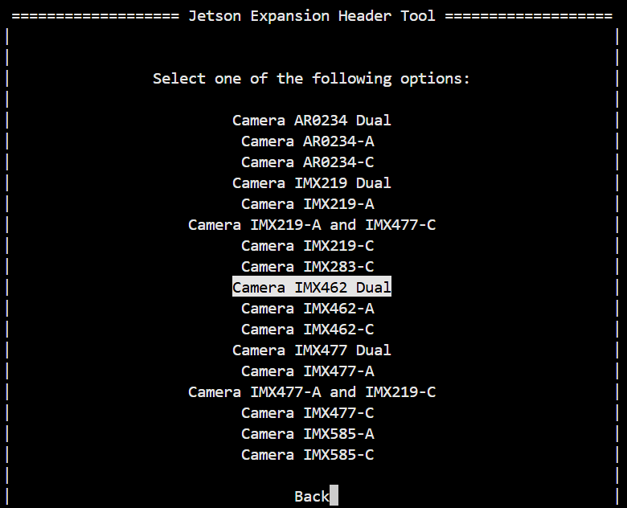

# IMX462 kernel driver for NVIDIA Jetson

[](https://github.com/Kurokesu/imx462-jetson-driver/actions/workflows/code-style.yml)
[](https://github.com/Kurokesu/imx462-jetson-driver/tags)


NVIDIA Jetson Orin kernel driver for Sony IMX462, a 2 MP 1/2.8" STARVIS back-side illuminated CMOS sensor optimised for low-light and night-vision applications.

Current driver capabilities:

- 2-lane MIPI CSI-2
- 10-bit and 12-bit RAW output
- 1920×1080 @ 60 fps
- HCG (High Conversion Gain) mode for improved low-light SNR
- Color and mono

> [!NOTE]
> 4-lane support for cam1 is planned.


*IMX462 camera modules are available at [kurokesu.com](https://www.kurokesu.com/item/462C-CSI)*

## Setup

Install required tools:

```bash
sudo apt install -y --no-install-recommends dkms
```

Clone this repository:

```bash
cd ~
git clone https://github.com/Kurokesu/imx462-jetson-driver.git
cd imx462-jetson-driver/
```

Run setup script:

```bash
sudo ./setup.sh
```

Setup script:

- Fetches NVIDIA device tree headers required for build
- Builds and installs kernel module via [DKMS](https://github.com/dell/dkms)
- Builds and copies device tree overlay (`.dtbo`) to `/boot`
- Installs ISP tuning to `/var/nvidia/nvcam/settings/`
- Installs udev rule keeping camera RTCPU awake

Use Jetson-IO to configure CSI connector:

```bash
sudo /opt/nvidia/jetson-io/jetson-io.py
```

Navigate through the menu:

1. Configure Jetson CSI Connector (named "22pin" on 6.2.2+, "24pin" on 6.2.1)
2. Configure for compatible hardware
3. Select port configuration:

    - `Camera IMX462-A` - cam0 (2-lane)
    - `Camera IMX462-C` - cam1 (4-lane)
    - `Camera IMX462 Dual` - cam0 (2-lane) + cam1 (4-lane)

    

4. Save pin changes
5. Save and reboot to reconfigure pins

After reboot, verify sensor is detected:

```bash
sudo dmesg | grep imx462
```

Expected output (dual):

```
nv_imx462: module verification failed: signature and/or required key missing - tainting kernel
imx462 9-001a: tegracam sensor driver:imx462_v2.0.6
tegra-camrtc-capture-vi tegra-capture-vi: subdev imx462 9-001a bound
imx462 10-001a: tegracam sensor driver:imx462_v2.0.6
tegra-camrtc-capture-vi tegra-capture-vi: subdev imx462 10-001a bound
```

*Signature warning is expected since DKMS modules are unsigned.*

## Image output

Sensor modes, selected with Argus `sensor-mode` or V4L2 `sensor_mode`:

| Mode | Resolution | Bit depth | V4L2 format | Max fps |
| ---- | ---------- | --------- | ----------- | ------- |
| 0    | 1920×1080  | 10-bit    | `RG10`      | 60      |
| 1    | 1920×1080  | 12-bit    | `RG12`      | 60      |

### GStreamer

Single:

```bash
gst-launch-1.0 -e nvarguscamerasrc sensor-id=0 ! \
   'video/x-raw(memory:NVMM),width=1920,height=1080,framerate=30/1' ! \
   queue ! nvvidconv ! queue ! nveglglessink
```

Dual:

```bash
gst-launch-1.0 -e \
   nvarguscamerasrc sensor-id=0 ! \
      'video/x-raw(memory:NVMM),width=1920,height=1080,framerate=30/1' ! \
      queue ! nvvidconv ! queue ! nveglglessink \
   nvarguscamerasrc sensor-id=1 ! \
      'video/x-raw(memory:NVMM),width=1920,height=1080,framerate=30/1' ! \
      queue ! nvvidconv ! queue ! nveglglessink
```

Argus picks 12-bit mode by default. Select 10-bit mode with `sensor-mode=0`:

```bash
gst-launch-1.0 -e nvarguscamerasrc sensor-id=0 sensor-mode=0 ! \
   'video/x-raw(memory:NVMM),width=1920,height=1080,framerate=30/1' ! \
   queue ! nvvidconv ! queue ! nveglglessink
```

### nvgstcapture

```bash
nvgstcapture-1.0 --sensor-id 0
```

### Raw V4L2

Install `v4l-utils` and OpenCV:

```bash
sudo apt install -y v4l-utils
sudo apt install -y python3-opencv
```

> [!IMPORTANT]
> With dual overlay, NVIDIA maps cam1 to `/dev/video0` and cam0 to `/dev/video1`.

Stream raw data to file:

```bash
v4l2-ctl -d /dev/video0 --set-ctrl bypass_mode=0,sensor_mode=0,override_enable=1,frame_rate=30000000,exposure=10000,gain=150 --set-fmt-video=width=1920,height=1080,pixelformat=RG10 --stream-mmap --stream-to imx462_1080p.raw --stream-count=1 --stream-skip=10 --verbose
```

12-bit mode:

```bash
v4l2-ctl -d /dev/video0 --set-ctrl bypass_mode=0,sensor_mode=1,override_enable=1,frame_rate=30000000,exposure=10000,gain=150 --set-fmt-video=width=1920,height=1080,pixelformat=RG12 --stream-mmap --stream-to imx462_1080p_12bit.raw --stream-count=1 --stream-skip=10 --verbose
```

*`override_enable=1` applies frame rate, exposure and gain. Without it sensor runs mode defaults. Frame rate is in fps × 1000000, exposure in µs and gain in 0.1 dB.*

View raw file:

```bash
python3 view_raw.py ./imx462_1080p.raw
python3 view_raw.py --mono ./imx462_1080p.raw  # mono sensor
python3 view_raw.py --bit-depth 12 ./imx462_1080p_12bit.raw
```

## HCG mode

IMX462 supports High Conversion Gain (HCG) mode for improved signal-to-noise ratio in low-light conditions. Default is Low Conversion Gain (LCG).

Enable HCG:

```bash
echo 1 | sudo tee /sys/module/nv_imx462/parameters/hcg_mode
```

Switch back to LCG:

```bash
echo 0 | sudo tee /sys/module/nv_imx462/parameters/hcg_mode
```

## Test mode

IMX462 has a built-in test pattern generator for verifying data validity.

Enable test pattern:

```bash
# Horizontal color-bar chart example (test_mode = 2)
echo 2 | sudo tee /sys/module/nv_imx462/parameters/test_mode
```

Turn test pattern off:

```bash
echo 0 | sudo tee /sys/module/nv_imx462/parameters/test_mode
```

| Test pattern code | Description |
| ----------------- | ----------- |
| 0 | Off |
| 1 | Sequence Pattern 1 |
| 2 | Horizontal Color-bar Chart |
| 3 | Vertical Color-bar Chart |
| 4 | Sequence Pattern 2 |
| 5 | Gradation Pattern 1 |
| 6 | Gradation Pattern 2 |
| 7 | 000h/555h Toggle Pattern |

## ISP tuning

Tuning file carries ISP parameters calibrated for this sensor: black level, lens shading, white balance and color correction. Global `camera_overrides.isp` applies to every camera and would shadow it, so setup retires it to `camera_overrides.isp.bak`.

Setup installs tuning files to `/var/nvidia/nvcam/settings/`. `kurokesu_front_462CSI.isp` and `kurokesu_rear_462CSI.isp` get linked to `kurokesu_462CSI.isp`.

To restore default ISP parameters, remove tuning files and restart Argus:

```bash
sudo rm /var/nvidia/nvcam/settings/kurokesu_*462CSI*.isp
sudo systemctl restart nvargus-daemon
```

### Mono sensor

Point port's symlink at mono tuning:

```bash
cd /var/nvidia/nvcam/settings
sudo ln -sf kurokesu_462CSI_mono.isp kurokesu_front_462CSI.isp  # cam0
sudo ln -sf kurokesu_462CSI_mono.isp kurokesu_rear_462CSI.isp   # cam1
sudo systemctl restart nvargus-daemon
```

Switch back to color by linking `kurokesu_462CSI.isp` instead.

## RTCPU keep-awake

On JetPack 6 camera RTCPU suspends after 5 s idle and redoes NVCSI calibration on resume. When that fails, next Argus (`nvarguscamerasrc`) launch gets no frames until reboot:

```
SCF: Error InvalidState: Timeout!! Skipping requests on sensor GUID 0 ... (FusaCaptureViCsiHw.cpp, function waitCsiFrameStart())
```

`setup.sh` installs `udev/99-camera-rtcpu.rules` to keep RTCPU awake, as NVIDIA [suggests](https://forums.developer.nvidia.com/t/issue-about-nvcsi/299349). Manual alternative, lasts until reboot:

```bash
echo on | sudo tee /sys/devices/platform/bc00000.rtcpu/power/control
```

## Development builds

For manual builds without DKMS:

```bash
make              # build everything (dtbo + kernel module)
sudo make install # copy dtbo to /boot, rmmod + insmod
```

> [!NOTE]
> Module is loaded immediately via `insmod` but won't persist across reboots. Use `sudo ./setup.sh` for permanent installation via DKMS.

Individual targets:

```bash
make dtbo      # build only the device tree overlay
make module    # build only the kernel module
make clean     # remove build artifacts
```

Build artifacts are placed in `./build`.
